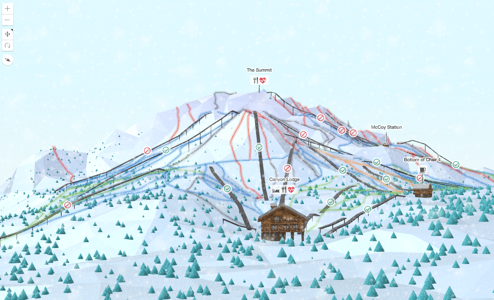

For a while I had an obsession with low poly art and I started
investigating how to create that with ArcGIS Maps SDK for JavaScript.

After doing some [research on low poly styles](https://www.esri.com/arcgis-blog/products/js-api-arcgis/3d-gis/3d-maps-in-low-poly-style), I ended
up creating a low poly ski map of Mammoth, a ski resort in California.

The live version lives [on GitHub](https://ralucanicola.github.io/ski-resort-map/).

And my colleague Arno and I also wrote about it: 

- [A low poly ski resort map - part I: generating the terrain](https://www.esri.com/arcgis-blog/products/js-api-arcgis/3d-gis/low-poly-ski-resort-map-1)
- [A low poly ski resort map - part II: add thematic data](https://www.esri.com/arcgis-blog/products/js-api-arcgis/3d-gis/low-poly-ski-resort-map-2)
